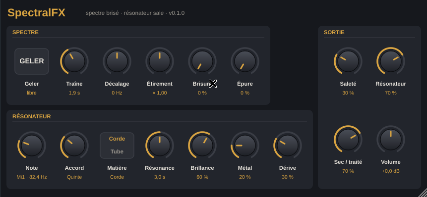

# SpectralFX

Effet VST3 expérimental pour Cubase : **spectre brisé + résonateur sale**.
Il transforme n'importe quelle source (guitare, basse, batterie) en drones métalliques
et en textures accordées.



**Mode d’emploi : voir [NOTICE.md](NOTICE.md).**

## Trajet du son

1. **Spectre brisé** (C++, `src/Spectre.h`) : le son est découpé en tranches qui se chevauchent
   (FFT de 2048 points à 44,1/48 kHz, 4096 à 88,2/96 kHz, 8192 au-delà). Pour chaque composante,
   on connaît sa fréquence exacte (vocodeur de phase). On peut la prolonger (Traîne), la figer (Geler),
   ne garder que les pics (Épure), l'éparpiller (Brisure), la multiplier (Étirement) ou la décaler (Décalage).
2. **Résonateur sale** (Faust, `dsp/resonateur.dsp`) : 4 résonateurs par canal (boucle à retard
   accordée, passe-tout pour l'effet « métal », filtre de brillance, saturation douce dans la boucle),
   accordés sur une note et un accord, puis saturés.
3. **Mouvement** (C++, `src/Moteur.h`) : un modulateur lent (libre ou calé sur le tempo de l'hôte ;
   sinus, triangle, hasard doux, hasard net) qui agit sur Décalage, Étirement, Brisure, Note et Saleté,
   et peut recapturer le spectre gelé à chaque cycle (Regel).
4. **Mélange** (C++, `src/Moteur.h`) : son sec retardé de la même latence, mélange, volume.

Pourquoi la partie spectrale est en C++ : Faust ne sait pas faire proprement une FFT avec
gel et déplacement des fréquences ; une banque de filtres en Faust aurait donné un gel flou.

## Organisation

- `dsp/resonateur.dsp` : partie Faust (testable seule sur https://faustide.grame.fr).
- `generated/` : C++ produit par Faust (`scripts/generate.sh`).
- `src/` : moteur (`Spectre.h`, `Moteur.h`) et enveloppe JUCE 8 (processeur, interface).
- `outils/` : essais hors Cubase (`rendu.cpp` passe un WAV dans le moteur avec un scénario de réglages,
  `source.py` fabrique un son d'essai).
- `.github/workflows/build.yml` : compilation Windows (VST3 + application autonome) et test pluginval.

## Compiler sous Linux

```
scripts/generate.sh /chemin/faust /chemin/faust/libraries
cmake -B build -DCMAKE_BUILD_TYPE=Release
cmake --build build --parallel
```
